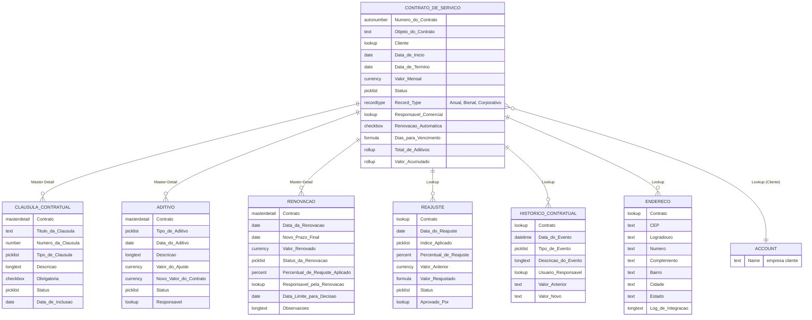

# Diagrama do Modelo de Dados

> Diagrama visual dos 7 objetos e seus relacionamentos. O GitHub renderiza este diagrama automaticamente (é um diagrama Mermaid, escrito em texto e versionado como qualquer outro arquivo).

## Como ler o diagrama

- `||--o{` = relacionamento **Master-Detail** (pai/filho forte — se o Contrato for excluído, o filho vai junto)
- `}o--||` = relacionamento **Lookup** (ligado, mas independente)
- Cada caixa lista os principais campos daquele objeto, com o tipo entre o nome do campo e sua descrição

Documentação completa de cada campo: [03-modelo-de-dados.md](03-modelo-de-dados.md).
